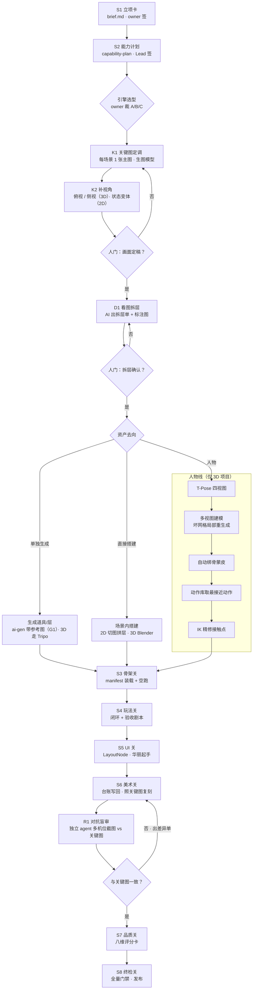

# AI 协同生产流程图（v1 · 2026-10-16）

> owner 2026-10-16 令：拆解《The Little Prince: Across the Stars》式 AI 制作流程，形成**我们自己的开发流程图**，并入项目开发流程。
> 本文 = 拆解 + 分析 + 新流程图。它**不替代**八阶段生产板（`docs/playbooks/game-production.md`），而是把 AI 工具链**挂到 S1–S8 上**：每一步落在哪一关、由谁做、过哪道门。
> 首个试用项目：game115《最后的火柴》（`docs/design/game115/brief.md`）。

---

## 1. 原流程拆解（owner 转述版·名称已校正）

> 来源：owner 转述的制作分享 + 公开报道（作者 Sac 只公开了工期与工具组合，完整流程称将开源；以下属二手资料，无法逐项核实）。
> 名称校正：Triple/Tribal → **Tripo**；Ops → **Opus 5.5**；Autore rig Pro → **Auto-Rig Pro**；Astra → **GPT-6 Astra**。

**分工**：Fable 5.1 写需求文档 · GPT Image 2.5 出图 · Tripo 做模型 · Opus 5.5 写代码并操控 Blender / Unity · GPT-6 Astra 修 bug。

**场景三步**
1. 用 Image 2.5 先定一张满意的场景图，再补俯视、侧视角度。
2. 让 AI 看图拆资产：哪些交给 Tripo 单独生成、哪些在 Blender 里直接搭，标在图上，**人来确认**。
3. 把 Tripo 做好的道具和参考图一起交给 Opus 照图复刻；做完派**独立审查 agent 多机位盲审**，和参考图不一样就接着改。

**人物四步**
1. Image 2.5 出 T-Pose 四视图。
2. Tripo SmartMesh P2.0 多视图生成模型，网格不对就局部重生成。
3. 用 Auto-Rig Pro 自动绑骨蒙皮。
4. 去 Mixamo 找动作；没有现成的（如提水壶）就找最接近的，再用 IK 把手一点点对到壶把上。

**三点启发**：① 从统一的生图开始，先把画面定下来，风格就好控；② 复杂场景启用对抗式审查，另一个 agent 专门挑刺；③ 自动化程度已很高，建模、绑骨、写代码基本都是 agent。

---

## 2. 分析：哪些我们已有、哪些要改、哪些是缺口

| 原流程环节 | 我们现状 | 判定 |
|---|---|---|
| 需求文档先行 | S1 立项卡 + S2 capability-plan（Lead 过审才动工） | ✅ 已覆盖，更严 |
| **先定一张关键图，再补视角** | 现行美术线是「台账逐行出图」（`docs/playbooks/art-pipeline.md` 八步），风格锚是**文字**；没有「整图定调」这一步 | 🔶 **流程要改**：关键图前置到 S2 之后、S3 之前 |
| 看图拆资产 · 标图 · 人确认 | 台账由 manifest `art:` / `skinKey` 槽推导，不从图出发 | 🔶 **流程要改**：新增「拆层单」工件 + 人门 |
| 道具单独生成 | `scripts/ai-gen.mjs` 逐行生成 | ✅ 已有 |
| **带参考图生成**（风格/造型一致） | `ai-gen.mjs` 无参考图入参；art-pipeline「查不到」节点名点「参考图模式」须提单 | ❌ **缺口 G1** |
| 照图复刻 | S3–S5 施工 | ✅ 已有 |
| **独立 agent 多机位盲审** | 复查门（复查人 ≠ 施工人）+ self-check 截图对齐单；但对齐对象是 **GDD 文字**，不是**参考图** | 🔶 **流程要改**：对齐单增「参考图比对」段 |
| 人物 T-Pose → 多视图建模 → 绑骨 → 动作 → IK | 引擎能载 glTF（`src/renderer/three/models.ts`），**只播单 clip、无混合/状态机、无 IK**；外部模型导入未标准化（`docs/design/3d-asset-pipeline-standard.md` §0） | ❌ **缺口 G2–G4**（仅 3D 项目需要） |
| AI 修 bug | 施工 → 撤修验红 → 复查门 | ✅ 已有，纪律更严 |

**结论**：原流程最值钱的是**两个前置/后置的「图」**——前面用一张图定调，后面拿同一张图挑刺。我们的门禁骨架已经比它严，缺的正是这两张图。

---

## 3. 新流程图

### 3.1 新增步骤定义（插在原八关之间·不改八关语义）

| 步 | 插在 | 做什么 | 产物（落 `docs/design/<slug>/`） | 门 |
|---|---|---|---|---|
| **K1 关键图定调** | S2 后 · S3 前 | 每场景出一张主图，统一画风从它开始 | `keyart/<scene>.png` + `keyart/README.md`（提示词、模型、种子） | — |
| **K2 补视角** | K1 后 | 3D：俯视 / 侧视；2D：状态变体（如火苗强弱） | `keyart/<scene>-<view>.png` | **人门：画面定稿**（owner 签） |
| **D1 看图拆层** | K2 后 | AI 把主图拆成资产清单，标注每项去向（单独生成 / 直接搭 / 人物），清单逐项对应皮肤槽 | `asset-split.md` + `keyart/<scene>-split.png`（标注图） | **人门：拆层确认**（owner 签）→ 再进台账 |
| **R1 对抗盲审** | S6 后 · S7 前 | **非施工 agent** 多机位/多帧截图，与关键图逐项比对（构图、色调、光源、层次、比例），出差异单；不一致回 S6 | `self-check/R1-keyart-review.md` + `self-check/shots/` | **复查门**（复查人 ≠ 施工人·按 `docs/playbooks/review-gates.md` 四步铁律） |

### 3.2 硬规则

- **关键图是 S6 的唯一视觉基准**：R1 只比关键图，不比「我觉得好看」；关键图要改，回 K2 重签。
- **拆层单 = 台账来源**：D1 每行必须落到一个真实消费槽（`art:` 或 `skinKey`），与 art-pipeline「台账只列有消费槽的行」同律；无槽行不许进台账。
- **盲审 = 不给施工说明**：复查 agent 只拿关键图 + 截图，不读施工方的自陈，避免被引导。
- **AI 只开方子、人点头**：K2 / D1 两道人门不可由 agent 代签（同 game-production「不许代签」）。

---

## 4. 引擎分支（待 owner 裁 A/B/C）

| | A. ZeroCraft（自研） | B. Unity | C. Godot |
|---|---|---|---|
| 场景线（K1–D1–R1） | ✅ 全可用 | ✅ | ✅ |
| 人物线（G2–G4） | ❌ 需先补引擎 | ✅ 现成（人形重定向 + IK 工具） | 🔶 可用，链路需自建 |
| S3–S8 门禁 | ✅ 全套现成 | ❌ 需另建 | ❌ 需另建 |
| 推荐用途 | **2D 项目 · 系列首章** | 必须 3D 且求快 | 不推荐（两头不占） |

Lead 推荐：game115 走 **A + 2D**（人物线不触发）；人物线缺口留给系列后续 3D 章，届时再裁。

---

## 5. 缺口清单（未入池·待 owner 判 A/B）

> 引擎池 `requests.md` 现 10/10 满槽；以下按缺口裁决协议先摆路，owner 判后再入对应池。

| # | 缺口 | 实查 | A 补能力 | B 不补 | 影响 |
|---|---|---|---|---|---|
| **G1** | 带参考图生成 | `scripts/ai-gen.mjs` 无参考图入参 | 扩 `ai-gen` 支持参考图 / 图生图（工具面·🔴 走主程） | 只用文字风格锚，靠人工挑图保一致 | **K1/D1 核心**，2D 也需要 · **推荐 A** |
| G2 | 外部模型导入标准 | `3d-asset-pipeline-standard.md` §0「模型线最散」 | P3D 补 glb 导入 + scale/校验 | 手工导入 | 仅 3D |
| G3 | 动画混合 / 状态机 | 只播单 clip；`docs/design/godot-vs-apollo.md` §4A 已列为最高借鉴项 | P3D 下沉 `AnimGraph3D`（render-only） | 单 clip 硬切 | 仅 3D |
| G4 | IK（手对物体） | `src` 内无 IK 实现 | P3D 下沉 render-only IK | 选不需接触的动作 / 改镜头回避 | 仅 3D |

---

## 6. 首个试用：game115

- K1/K2：7 个场景各出一张主图 + 火苗强 / 弱两档变体。
- D1：拆成 `capability-plan.md §4.5` 的六类皮肤槽（背景 / 幻象层 / 热点物件 / 小女孩姿态 / 火柴 / 相册卡）。
- R1：每章截火苗强、中、弱三帧，与关键图比对。
- 人物线：不触发（2D 剪影）。
